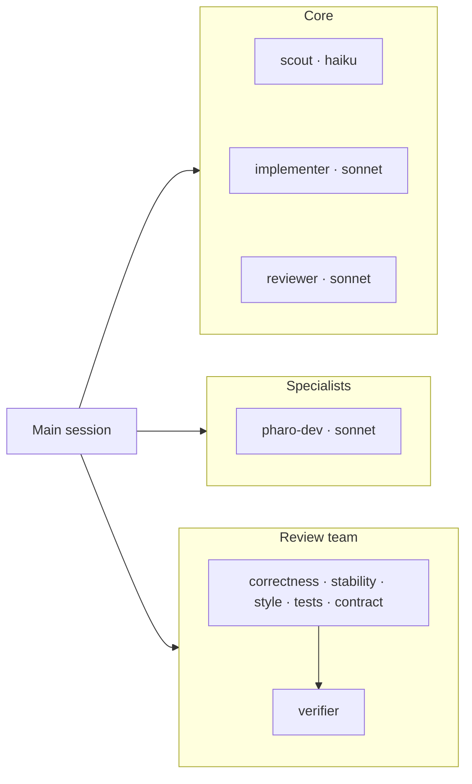

# badetitou-team

A Claude Code plugin (`badetitou-team`) that sets up and improves teams of Claude agents, one
project at a time.

- **Investigates** a project: stack, MCP servers (local or not), existing
  `.claude` config, memories and past sessions.
- **Sets up** a lean team: `CLAUDE.md`, a few narrow agents on the cheapest
  model that does the job, `.mcp.json`, and a team manifest (`.claude/team.md`).
- **Prepares tasks**: GitHub issue → project board, or GitLab work item →
  issue board + milestone → minimal PRs/MRs → a brief for the agent that does the work.
- **Improves itself**: retros read session stats (tokens, heavy tools, user
  corrections) and feed changes back into the project and into this repo.

## Teams



Details and a task's lifecycle: [docs/teams.md](docs/teams.md).

## Install

```sh
/plugin marketplace add badetitou/badetitou-team
/plugin install badetitou-team@badetitou
```

While developing this repo, use the local checkout instead:
`/plugin marketplace add ~/Documents/Perso/badetitou-team`.

## Contents

| Path | What |
| --- | --- |
| `skills/team-setup` | Investigate a project and write its team |
| `skills/task-prep` | Turn a request into an issue, minimal PR slices and a brief |
| `skills/team-retro` | Session stats → diagnosis → changes → retro log |
| `skills/github-flow` | Minimal PRs, English issues, GitHub Projects status, no attribution |
| `skills/gitlab-flow` | Same rules on GitLab: work items (issues + child tasks), issue boards, milestones, MRs |
| `skills/local-flow` | No remote yet: Markdown issues in `.claude/issues/`, a board script, export to `gh`/`glab` later |
| `skills/review-team` | Checks once, five lens reviewers per branch, one verifier that merges and refutes — before merging |
| `skills/pharo-mcp` | Live Pharo images via [Evref-BL/MCP](https://github.com/Evref-BL/MCP) |
| `skills/vscode-extension` | TypeScript/React VS Code extensions |
| `agents/` | Core: `scout` (haiku), `implementer`, `reviewer`; specialist: `pharo-dev`; review team: `review-*` lenses + `review-verifier`. Usable as-is, and templates for project agents |
| `docs/teams.md` | Diagrams of the teams and of a task's lifecycle |
| `hooks/` | Session-start nudge: no team yet, or retro overdue (one line, only when relevant) |
| `templates/project/` | `CLAUDE.md` and `team.md` for a new project |
| `catalog/references.json` | External skills, plugins and MCP servers to reuse; `scripts/sync-refs.sh` clones them into `vendor/` |
Per-user state lives in `~/.claude/badetitou-team/`, outside this repo:
`projects.json` (projects that have a team, paths, last retro) and
`retro-log.md` (history of retros and what changed).

## Typical use

- In a new project: *"set up a team for this project"* → `team-setup`.
- New work: *"I want …"* / *"work on #12"* → `task-prep`, then implement.
- Before merging: *"review the branches"* → `review-team`.
- Every couple of weeks (the hook reminds you): *"retro"* → `team-retro`.
