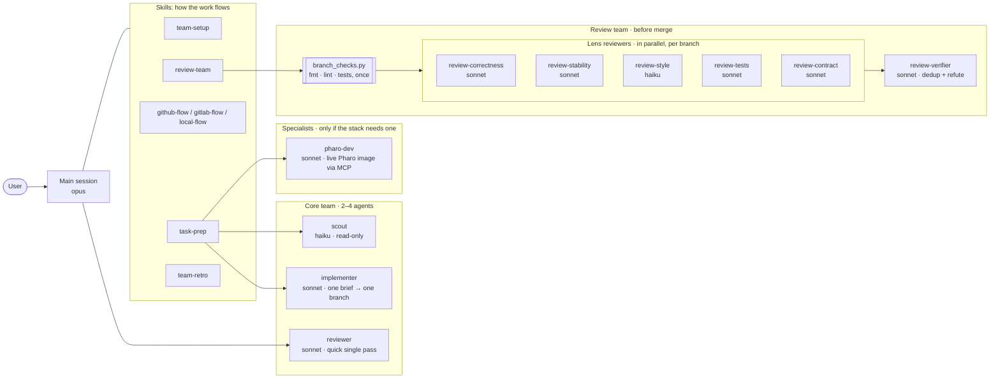
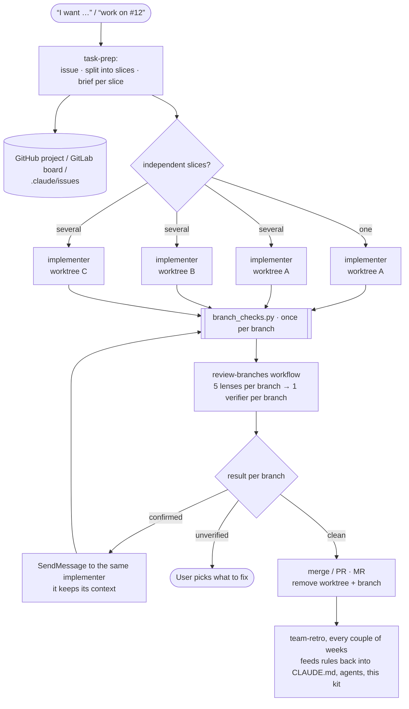

# Teams

A project's team has three groups. The **core** is always there; a
**specialist** joins only when the stack needs one; the **review team** is
called before merging task branches. Skills orchestrate them; agents do the work.

## Who is in the team

## A task, end to end

## Why this shape

- **Cheap where possible**: exploration on haiku, style lens on haiku, the
  main session only orchestrates.
- **Several reviewers, one verifier**: a narrow lens digs deeper than a
  generalist, so lenses stay separate. Verification is grouped per branch,
  which removes the duplicates the lenses share. In the Structure run, one
  verifier per finding cost twice the review itself.
- **Checks once**: fmt, lint and tests run by script before the reviewers,
  who read the output instead of rebuilding the branch.
- **Unverified ≠ rejected**: missing-test and low-severity findings are
  judgment calls; they go to the user instead of a verifier.
